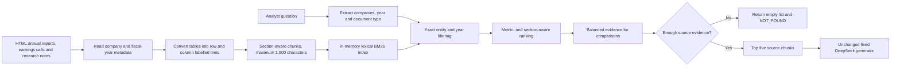

# FTEC5660 Homework 4

## Homework 4 solution

### Pipeline and design

The implementation extracts the reviewed company's legal name from each HTML document's main heading, identifies the fiscal year and document type, and preserves table captions, row labels, year-column labels and printed values during HTML-to-text conversion. It chunks narrative by headings and table rows, never exceeding 1,500 characters, and places `source`, `company`, `fiscal_year` and `doc_type` on every LangChain `Document`. An in-memory BM25 index ranks source passages lexically without embeddings or external data. A rule-based question parser identifies named firms (including firms absent from the library), the year mentioned in the question and the correct report type. Exact company filtering prevents look-alike names from being confused, while temporal filtering allows the comparative prior-year column in annual statements and future estimates in research reports. Metric phrases, section names and segment/geographic qualifiers improve ranking. For two-company comparisons, the retriever reserves evidence for both companies. A conservative abstention check returns an empty list for unsupported company-year combinations or missing metric labels rather than forcing the fixed generator to guess.

### Ablation study: public_test

Each variant changes exactly one named component relative to the previous variant. B0 follows Tutorial 7's naïve parsing/splitting and lower-cased whitespace BM25, retrieves five chunks without metadata filtering and never deliberately abstains. `ablation.py` re-builds each configuration and runs the starter's *original scoring functions* on the provided test data.

Public-test results have **not** been run in this environment. Run `python ablation.py --data-folder public_test` to generate measured table values here.

**Interpretation of one-component changes**

The ablation script will replace this placeholder with measured change-by-change comparisons.

**Error analysis**

The ablation script will list actual retrieval and abstention errors after testing against the public corpus.

End-to-end accuracy requires the instructor’s fixed DeepSeek generator and a user-supplied API key; no accuracy claim is made here.

The sample is synthetic and small. Public-set changes may not transfer to private companies and differently worded questions; the above comparison is descriptive rather than a statistical significance claim. Source-level recall alone is not sufficient for exact-number answers, because a retrieved passage can contain both 2024 and 2025 columns. We therefore preserve captions and per-cell year labels and verify end-to-end behavior with the unchanged generator when an API key is available.

### Reproducibility

Python 3.10+; use the instructor's `requirements.txt`. No embedding model, hosted search, hard-coded corpus answers or additional API clients are used. A fresh runner builds its index from the supplied documents. The `ablation.py` experiment changes only feature switches in the student's code; the provided generator, scoring and main runner remain untouched. The `.env`, API key and any serialized index must stay out of Git. Run `python hw4.py --data-folder public_test` to generate `results.csv` and `python ablation.py --data-folder public_test` to generate retrieval-only ablation measurements.

## Task 6: Reflection — Who do I want to be in the age of AI agents?

Ten years from now, if AI agents can write reports, analyze markets, develop software, and make many decisions faster than people, I do not want to define myself by how many tasks I can complete. I want to be someone others can trust with difficult decisions: a person who listens carefully, explains uncertainty, and accepts responsibility when technology affects real lives.

My ambition to work in finance and technology would still matter, but its meaning would change. Instead of competing with AI to produce one more accurate spreadsheet or one more efficient model, I would want to understand which problems deserve attention and whose interests are being overlooked. In financial services, an apparently small error can affect a family's savings, a firm's access to credit, or a person's future opportunities. Faster analysis only becomes valuable when it serves a worthy objective.

Beyond my career, I would like to be known as a dependable friend, a curious learner, and a person who treats others with dignity. I hope people remember not only the quality of my work but also whether I was fair when there was a conflict, patient when someone needed help, and willing to admit mistakes. These qualities cannot be reduced to productivity scores.

I would still choose to struggle with learning difficult concepts, building relationships, and making moral judgments. AI might give me a perfect summary of an academic paper, but working through the argument myself teaches me how to ask better questions. AI could draft a difficult conversation, but I still need to find the courage to have it. Some forms of effort are valuable because they transform the person doing them, not only because they produce an outcome.

My lasting skills would include critical thinking, empathy, intellectual honesty, communication, and the ability to connect technical details with human consequences. I should know when to use an agent, when to challenge it, and when not to automate a decision. If competence becomes abundant, identity will come less from outperforming others and more from the commitments I keep: the people I care for, the principles I defend, and the responsibilities I do not outsource.

Tomorrow I should begin with a small practical change. When I use AI for study, I will first write down my own understanding of the question, then compare it with the agent's answer and verify its evidence. I will spend time reading things without immediately requesting a summary, and I will give my full attention to conversations without multitasking. The aim is not to avoid AI. It is to use powerful tools while continuing to become a thoughtful, trustworthy human being.